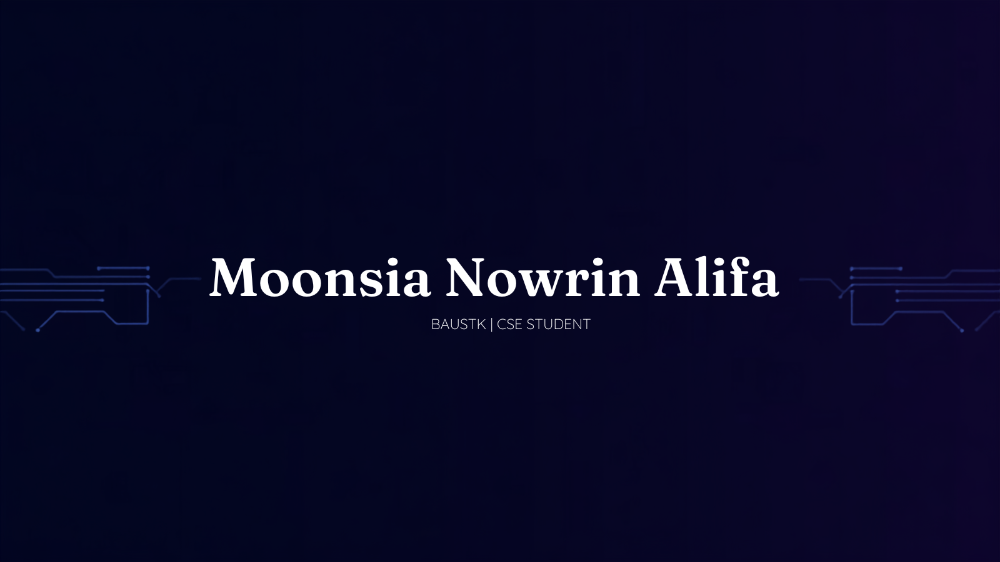

<h1 align="center">Hi, I'm Moonsia Nowrin Alifa 👋</h1>

  <b>CSE Student @ BAUST · Entering Final Year</b> 
  Building projects, learning by doing, and growing as a developer.

  
  

---

## 👩‍💻 About Me

I'm a Computer Science & Engineering student at BAUST, moving into my final year after completing my third year.

I enjoy turning ideas into practical projects and exploring both software and hardware. I'm focused on strengthening my programming fundamentals, learning through hands-on development, and building a solid foundation for my career in technology.

## 🛠️ Tech Stack

**Programming Languages**

  
  
  
  

**Web & Database**

  
  
  
  

**Tools & Embedded Systems**

  
  
  
  
  

## 📌 Featured Projects

### 📚 [StudyBuddy – Student Buddy Finder](https://github.com/moonsia-sys/Study_Buddy)
A student-focused web application where students can create profiles, find study partners, send buddy requests, and communicate.

**Tech:** PHP · MySQL / MariaDB · HTML · CSS

### 🍽️ [Subscription-Based Meal Plan System](https://github.com/moonsia-sys/meal-plan-system)
A database project for managing customer meal subscriptions, meal plans, and order history, with a focus on relational database design and SQL.

**Tech:** Oracle Database · SQL · PL/SQL

### 📡 [Smart 360° Radar System](https://github.com/moonsia-sys/smart-360-radar-system)
A hardware-software project using an ESP32 and ultrasonic sensor to detect nearby objects across a rotating 360-degree range and display distance data.

**Tech:** ESP32 · C/C++ · Arduino IDE · HC-SR04

## 📊 GitHub Stats

  
  

## 🌱 Currently Focused On

- Strengthening programming and problem-solving fundamentals
- Building practical software and database projects
- Learning more through hands-on development
- Preparing for my final year and the transition into professional life

---

  <i>Learning continuously. Building thoughtfully. Improving with every project.</i> ✨

